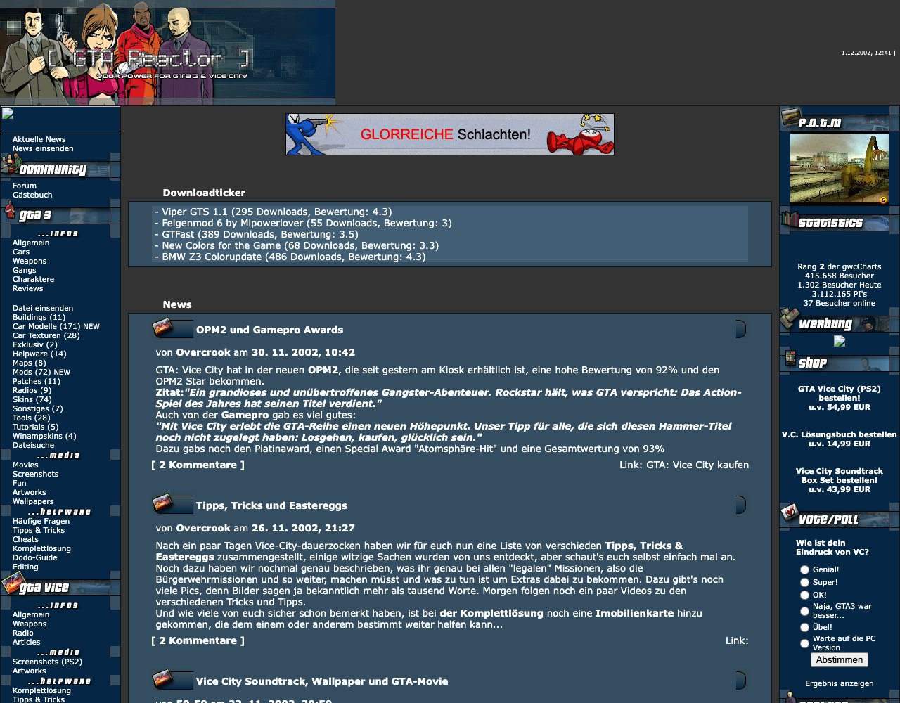
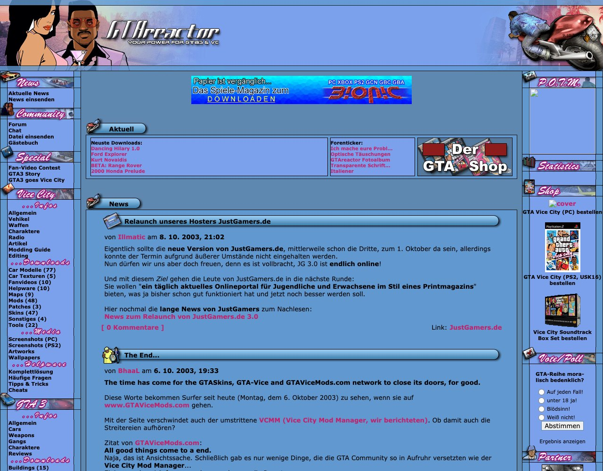
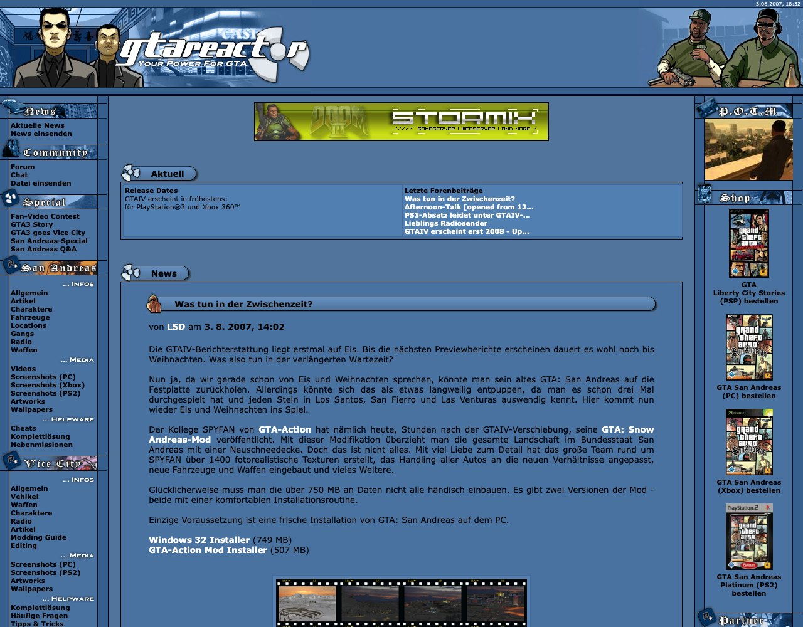
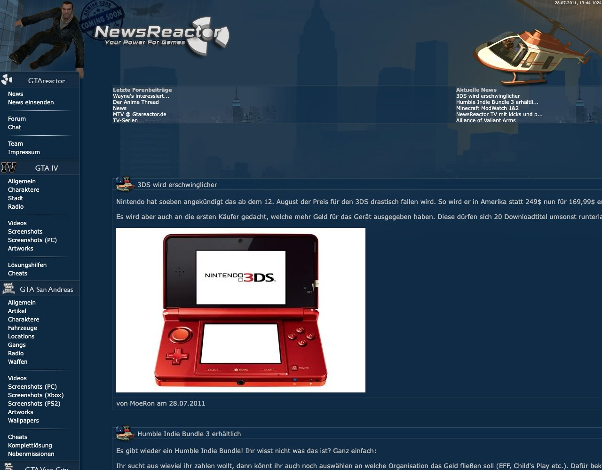
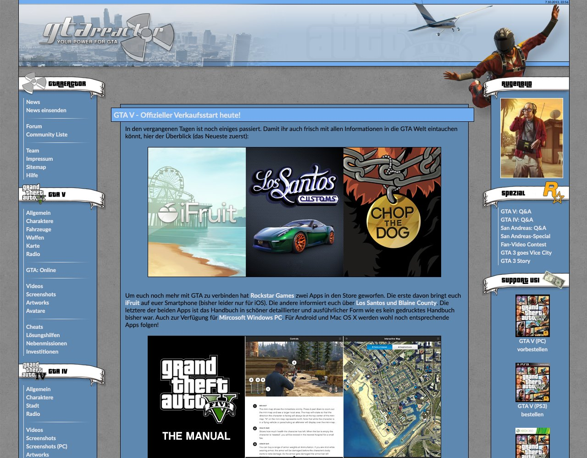
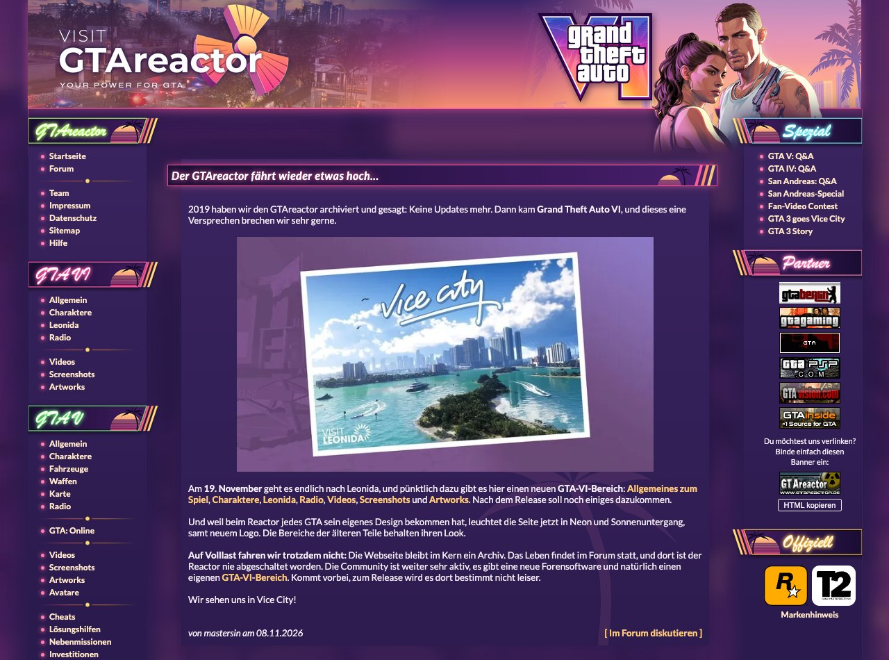

# The history of GTAreactor

[Deutsch](history.md) · **English**

> **Note:** This history does not claim to be complete. It only covers what we know so far. Were you there, do you know more, or do you have something to add? Then feel free to join in: [edit this page](https://github.com/GTAreactor/.github/edit/main/profile/history.en.md), open a pull request and help tell the story.

## The story so far

GTAreactor started as a German home for fans of Grand Theft Auto III. The site's own anniversary posts count its birthday from **1 August 2002**. On the second birthday, lotti wrote how it came about: "It all began on 1 August 2002. 'GTAreactor' was back then a merger between GTA3-World and, yes, 50-50 :D."

*GTA 3 - World* (gta3-world.de) was online by June 2002 at the latest, with news, downloads, a forum, a guestbook and a chat for GTA III. A post from 2013 remembers it as GTAreactor's first appearance and places it in 2001. The surviving pages cannot confirm that, so the roots may go back a little further.

The question of who founded the site also has more than one answer. The first-anniversary post in 2003 lists for August 2002 the "founding of GTAreactor.de and the forming of a web team with 50-50, lotti, the dev and Overcrook". Team pages from around 2007 to 2009 call 50-50 the founder. The 2013 relaunch post names lotti and the dev, and the team page from that time names lotti.

## Timeline

| When | Home | What happened |
|---|---|---|
| By June 2002 | gta3-world.de | *GTA 3 - World* is online |
| August 2002 | GamesWeb | GTAreactor starts; its own posts date this to 1 August |
| November 2002 | GamesWeb | Vice City category and a brighter design with "Miami flair" |
| February 2003 | Daddeltreff | Move to a new host, accompanied by several server outages |
| By autumn 2003 | JustGamers | New host; the forum moves to forum.gtareactor.de |
| October 2003 | JustGamers | Hackers wipe the download server and its backups |
| By May 2004 | JustGamers | San Andreas section, and a big special for the second birthday |
| Around autumn 2005 | Planet-Multiplayer | New host, until early 2009 |
| November 2008 | Planet-Multiplayer | The GTA IV design arrives, timed for the PC release |
| Early 2009 | gtareactor.de | The site runs directly on its own domain again |
| From May 2011 | gtareactor.de | More general gaming news; the forum is called NewsReactor for a while |
| 9 December 2012 | gtareactor.de | "The Reactor is shutting down...": the host is closing and the team looks for a successor |
| 10 September 2013 | gtareactor.de | The big relaunch, one week before GTA V |
| February 2018 | gtareactor.de | Site and forum move to a new server |
| 27 March 2019 | gtareactor.de | The site is archived and stays online; the forum carries on |
| November 2025 | Forum | The forum moves to WoltLab Suite |
| November 2026 | gtareactor.de | Static archive and new GTA VI section |

## Highlights

### 2002: Cars, Vice City and sleepless nights

*December 2002: the GTA III design, still hosted at GamesWeb at the time. Image: Internet Archive.*

The first weeks belonged to the modders. Overcrook and lotti announced new cars, tools and mods almost daily, and as early as August 2002 a 10,000-polygon Lamborghini prompted a warning that weaker PCs would compute themselves to death. By December the download menu counted 171 car models, 72 mods, 74 skins, 28 tools and 8 maps.

The wait for Vice City began at the same time. In early September Overcrook interviewed Take-Two Germany, and from October the countdown ran through the news with "Vice City - GOLD!" and "USK 16 confirmed". After a two-day outage, 50-50 announced "Back online!" on 1 October, with a completely new server. In autumn 2002 GTAreactor stood at number 1 in the GamesWeb network charts. In early December lotti wrote that the team had worked through the nights to finish new Vice City content.

### 2003: Explosive growth and a black October

*October 2003: the Vice City design. Image: Internet Archive.*

Between November 2002 and April 2003 visitor numbers rose "explosively", according to the site's own review, with up to 6,500 users on peak days. Vice City's PC release in May 2003 grew the community further, and downloads were now picked on the motto "quality over quantity". An Amazon partner shop helped pay the bills, and Daddeltreff provided web space and traffic for free.

For the first birthday, lotti told how the two webmasters, 1,000 kilometres apart, had only met in person at CeBIT. That summer GTAreactor ran the Summer Carmakin' Compo together with other fan sites. In an autumn poll, more than 70 percent said they came mainly for the downloads.

That made 15 October 2003 hit all the harder: "FTP server hacked - all downloads are gone", backups included. Rumours that GTAreactor was dead went around until December, when Brik announced the first new downloads. A second attack followed in February 2004. This time the front page was overwritten, and for hours the "dreary everyday Reactor" gave way to a "special edition of the Polish Gummi Bears".

### 2004 to 2008: San Andreas, Hot Coffee and the long wait for GTA IV

*August 2007: the San Andreas design, during the wait for GTA IV. Image: Internet Archive.*

On 1 March 2004, 50-50 reported the official announcement of San Andreas. A twelve-day Driv3r special ran in May, and the second birthday brought a big San Andreas update. lotti looked back on peaks of more than 5,000 visitors a day and a team of six, and thanked everyone who "never wrote GTAreactor off".

The Reactor followed the big stories of those years, from the 2005 Hot Coffee affair through Liberty City Stories and Vice City Stories to Multi Theft Auto. In September 2005 the "GTAreactor network" launched its own *The Warriors* site, nywarriors.de.

2007 became the year of the GTA IV hype, with 182 news posts in that year alone. On 1 March the Reactor counted down "not even 28 days until the GTA IV trailer!", and on 29 March came "the trailer is here". Then there were running topics like "GTA for Wii?", which made it to "Part 5". On 19 April LSD ran the headline "GTA6 kommt" ("GTA 6 is coming"): the British magazine PLAY had mistakenly announced a preview of GTA VI, with a layout artist apparently having "pressed the mirror key in Photoshop". It would take almost 20 more years. There was even room for pizza boxes with the GTA IV logo. When GTA IV was delayed to 2008 in August, the series "What to do in the meantime?" began. In April 2008 the time had come: gold status, and soon afterwards "IGN review with top score!!".

On 12 November 2008 the site finally got its new look: "The GTA IV design was overdue and we completely missed the 6th birthday," wrote Basti. The accompanying contest offered GTA IV fan packages for the best photo of yourself as a GTA IV character.

### 2009 to 2012: "Is the Reactor dead? No!"

*July 2011: the GTA IV design, by then with the NewsReactor logo. Image: Internet Archive.*

As early as 2007 the forum debated the site's future in a thread called "GTAreactor, quo vadis?". In early 2009 another thread asked whether the Reactor was dead, and the answer soon appeared in its title: "Is the Reactor dead? No!". After a four-month break, the news returned on 22 March 2009 with eight posts at once. The site was now back directly on gtareactor.de, and another server move followed in May 2010.

From May 2011 the site opened up to gaming in general, from Minecraft and Alan Wake to Steam sales, and the forum carried the name NewsReactor for a while. 2011 brought 174 news posts again, and that summer there was even a small series of its own, "NewsReactor TV". Rockstar announced GTA V in October 2011, but the Reactor was slowly running out of energy. On 9 December 2012 Yashinu wrote "Der Reactor fährt runter..." ("The Reactor is shutting down..."). The team no longer had the time, and the host was about to go offline. And: "Many friendships were formed here." The post ended by asking anyone who wanted to keep the Reactor running to get in touch.

### 2013: The big relaunch

*October 2013: the GTA V design after the relaunch. Image: Internet Archive.*

Someone did. A new team came together in summer 2013, and on 10 September, one week before GTA V, "The big GTAreactor relaunch 2013" went live. As -sCottY- promised: "But in 2012 no reactors were to be shut down in Germany just yet!" The system was rebuilt from scratch, the old content from GTA III to GTA IV was reworked, and new GTA V and GTA Online sections, a GTA V style and a new forum design arrived.

Between July and November 2013, 34 news posts appeared, among them "GTA V - official launch today!" on 17 September. GTA Online updates and a Snapmatic contest followed that autumn, and in November GTAreactor started tweeting. The last regular game news appeared on 27 November 2013: "GTA San Andreas on mobile from December".

### 2018 to 2026: Powering down, but never off

*November 2026: the GTA VI design of today's archive.*

In February 2018 mastersin announced a larger move, to "get the ship back on the water". On 27 March 2019 came the honest assessment: "After a long period of standstill, we have to admit it to ourselves." Seventeen years after its start, the site was archived. It stayed online, and the forum carried on.

In November 2025 the forum swapped its "antique" software for WoltLab Suite. And on 8 November 2026, after more than seven years, a news post appeared again: "Der GTAreactor fährt wieder etwas hoch..." ("The GTAreactor is powering back up a little...").

## Games and content

Each big release left its mark on the site. GTA III was followed by Vice City, San Andreas, GTA IV and GTA V, each with its own section and design. Liberty City Stories, Vice City Stories and Chinatown Wars were covered in the news.

There were also walkthroughs, cheats, a Dodo guide, modding guides, Q&A specials on San Andreas, GTA IV and GTA V, a Driver 3 section, a 20-chapter GTA III fan story and a Vice City fan-video contest. Today the archive holds more than 100 pages.

## The forum

For many, the forum was GTAreactor. A forum link was in the site menu by December 2002, and the Burning Board's own statistics go back to around late January 2003. By October 2003 it already had 2,392 members and 95,907 posts. It had boards for each game, an Editing area with a Showroom and a beta-test zone, and a spam board whose closure 50-50 announced in August 2003.

From 2003 it gave a home to the community around the **GTA: Berlin** mod. GTAreactor showed exclusive screenshots of the project in July 2003 and its first teaser that October. According to the German GTA Wiki the partnership lasted until autumn 2006, and the demo from late October 2007 was also available directly from the Reactor.

On 30 March 2007, one day after the first GTA IV trailer, 258 users were online at once, the forum's record. By February 2009 it had about 9,700 members and 459,000 posts, and by 2014 about 9,900 members and more than 477,000 posts. The forum has never been switched off and today stands at more than 479,000 posts.

## The people

Listed by the nicknames they used on the site's team pages.

- **At the start:** 50-50, lotti, the dev, Overcrook
- **Webmasters and admins over the years:** 50-50, lotti, illmatic, squiddy, BhaaL, Basti, Yashinu, -sCottY-, mastersin
- **Long-time technology and administration:** BhaaL
- **Team of the 2013 relaunch:** -sCottY-, mastersin and BhaaL (admins); th0m4s, LiveLife, Chronos and Yashinu (editors); Fabian, MoeRon, Eddy and Deluxo (forum moderators)
- **Also on the team at various times:** CromiX, pitschi2001, Brik, teensoldier, poomuckel, LSD, Iroul, Xulaxa, VuK, Tryade, n03de, Mehrwegflasche, Sidewalker
- **Remembered as honorary members:** lotti, 50-50, Overcrook, illmatic, teensoldier and, in memoriam, ODIE, the mind behind the GTA: Berlin forum

Thanks as well to everyone who moderated, wrote or joined the discussion and is not listed here.

## Today

Since November 2026, gtareactor.de has been a static archive, with redirects so that old addresses keep working. At its core it stays an archive, but the Reactor powered back up a little for GTA VI: a new section, added ahead of the 19 November release date given on the site, a neon-and-sunset theme and a new logo. A timeline and overview pages now also cover GTA 1, London, GTA 2, Advance, the Stories games, Chinatown Wars and the GTA IV episodes.

Do you remember it differently, or are you listed here and would rather not be? Let us know in the [forum](https://forum.gtareactor.de/).
